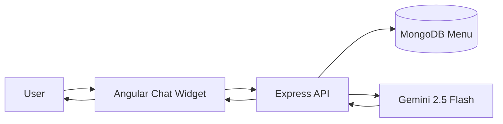

<div align="center">

# 🍔 FoodTech — Food Delivery SaaS Starter Kit

### _Browse. Order. Track. Manage. Chat with AI._

[](#tech-stack)
[](#tech-stack)
[](#tech-stack)
[](#tech-stack)
[](#tech-stack)
[](https://aistudio.google.com/)
[](#license)
[](https://foodtech-app-mean-stack.onrender.com/)

🌐 **[Live Demo — Try FoodTech Free →](https://foodtech-app-mean-stack.onrender.com/)**

 **[Live Video Demo  →](https://www.youtube.com/watch?v=mNUqGhLDCzo&t=9s)**


_A full-stack food ordering marketplace with 4-role RBAC, admin & vendor dashboards, Stripe + Cash on Delivery, real-time tracking, and a Gemini AI chatbot._

</div>

---

> **Purchased on Gumroad?** Start here: **[docs/GUMROAD-INSTALLATION-AND-RUN-GUIDE.md](docs/GUMROAD-INSTALLATION-AND-RUN-GUIDE.md)**  
> Docs index: [docs/README.md](docs/README.md) · License: [docs/LICENSE-COMMERCIAL.md](docs/LICENSE-COMMERCIAL.md)

---

## What is FoodTech?

**FoodTech** is a production-ready **food delivery SaaS starter kit** built on the **MEAN stack** (MongoDB, Express, Angular, Node.js) with TypeScript. It is designed for developers, agencies, and founders who want to launch an **Uber Eats–style** marketplace without building from scratch.

Unlike a simple checkout demo, FoodTech ships **four distinct user roles**, each with its own dashboard and workflow:

| Role | Dashboard | What they do |
|------|-----------|--------------|
| **Customer** | Menu, cart, orders | Browse, pay, track deliveries |
| **Vendor admin** | `/vendor/dashboard` | Manage menu items, view sales & orders |
| **Delivery person** | `/delivery` | Fulfill assigned orders, update delivery status |
| **Super admin** | `/admin` | Platform-wide CRUD, KPIs, driver assignment |

Also included: a **SaaS marketing landing page**, **Stripe + Cash on Delivery** checkout, **map-based delivery pinning**, a **5-step order tracking timeline**, and an **AI chatbot** grounded on your live MongoDB menu.

---

## Live demo

| | |
|---|---|
| **URL** | [https://foodtech-app-mean-stack.onrender.com/](https://foodtech-app-mean-stack.onrender.com/) |
| **Try as customer** | Browse `/foods`, add to cart, checkout, pay (Stripe test card or COD), track at `/orders` |
| **Try all roles** | Run `npm run seed:rbac` locally (see [Demo accounts](#demo-accounts)) |

---

## Features at a glance

### Customer experience
- **SaaS landing page** — hero, features, pricing, FAQ, and CTAs at `/`
- **Menu browsing** — search, tag filters, food detail pages
- **Shopping cart** — quantity controls, sticky summary, mobile cart drawer
- **Checkout** — Leaflet map pin-drop, GPS locate, reverse geocoding
- **Payments** — Stripe card payments (verified server-side) **or Cash on Delivery (COD)**
- **Track Orders** — order history cards + `/track/:id` with 5-step delivery timeline
- **Profile** — account details and quick navigation

### Vendor experience
- **Vendor dashboard** (`/vendor/dashboard`) — KPI cards, charts, menu CRUD
- **Vendor orders** (`/vendor/orders`) — read-only order list for the vendor
- Item performance analytics and recent orders table

### Delivery experience
- **Delivery dashboard** (`/delivery`) — orders assigned to the logged-in driver
- **Mark on the way** — `PAYED` → `SHIPPED`
- **Mark as delivered** — `SHIPPED` → `DELIVERED`
- **Fail to deliver** — `SHIPPED` → `DELIVERY_FAILED` with optional reason (e.g. COD unpaid)

### Super admin experience
- **Admin dashboard** (`/admin`) — lazy-loaded module with KPIs and charts
- CRUD for **users**, **vendors**, **foods**, **orders**, and **delivery personnel**
- Assign delivery drivers to orders
- **Mark completed** — `DELIVERED` → `COMPLETED`
- **Cancel failed orders** — `DELIVERY_FAILED` → `CANCELED`

### Platform & AI
- **4-role RBAC** — JWT auth, route guards, role-aware sidebar/header
- **Google Gemini chatbot** — answers menu, pricing, and ordering questions from live data
- **Responsive UI** — mobile nav, bottom bar, safe-area support, responsive dashboards
- **Toastr notifications** — cart, auth, checkout, payment, and error feedback

---

## Order lifecycle

```
NEW → PAYED → SHIPPED → DELIVERED → COMPLETED
                  ↘ DELIVERY_FAILED → (admin) CANCELED
```

| Status | Meaning | Who updates it |
|--------|---------|----------------|
| `NEW` | Order created, awaiting payment | Customer checkout |
| `PAYED` | Payment received (Stripe or COD) | Customer payment page |
| `SHIPPED` | Driver is on the way | Delivery dashboard |
| `DELIVERED` | Handed to customer | Delivery dashboard |
| `COMPLETED` | Order closed by platform | Super admin |
| `DELIVERY_FAILED` | Could not deliver (reason stored) | Delivery dashboard |
| `CANCELED` | Failed order canceled | Super admin |

Customers see a **5-step tracking timeline**: Order placed → Confirmed → On the way → Delivered → Completed.

---

## Role workflows

### Customer
1. Register or log in → redirected to `/foods`
2. Browse, search, filter → add items to cart
3. Checkout with map pin → create order (`NEW`)
4. Pay with **Stripe** (card) or **Cash on Delivery** → `PAYED`
5. Track at `/orders` or `/track/:id`

### Vendor admin
1. Log in → redirected to `/vendor/dashboard`
2. Create, edit, delete menu items
3. Review vendor orders and dashboard metrics at `/vendor/orders`

### Delivery person
1. Log in → redirected to `/delivery`
2. See orders assigned by super admin
3. Mark on the way, mark delivered, or fail delivery with reason

### Super admin
1. Log in → redirected to `/admin`
2. Manage users, vendors, foods, orders, delivery staff
3. Assign drivers, mark orders completed, cancel failed deliveries

> Detailed reference: [docs/06-order-workflow.md](docs/06-order-workflow.md)

---

## Demo accounts

After configuring `backend/src/.env`, seed demo data from the `backend` folder:

```bash
cd backend
npm run seed:rbac
```

| Email | Password | Role | Routes to try |
|-------|----------|------|---------------|
| `customer@foodtech.com` | `12345` | Customer | `/foods`, cart, checkout, `/orders` |
| `vendor@foodtech.com` | `12345` | Vendor admin | `/vendor/dashboard`, `/vendor/orders` |
| `delivery@foodtech.com` | `12345` | Delivery | `/delivery` |
| `super@foodtech.com` | `12345` | Super admin | `/admin` |

> **Production:** Remove or change seed users before going live. Re-login after seeding so JWT includes `role` and `vendorId`.

---

## AI chatbot — Google Gemini

Built-in customer support assistant that answers questions using **only your real menu data** — no invented dishes or prices.

**Try asking:**
- _"What foods do you have?"_
- _"What is the cheapest item?"_
- _"Do you serve shawarma?"_ → suggests alternatives if not on menu
- _"How do I place an order?"_



- **Endpoint:** `POST /api/chatbot/send-message`
- **Model:** `gemini-2.5-flash` with automatic fallback
- **Menu cache:** 60 seconds in memory, injected as system context

---

## Tech stack

| Layer | Technology |
|-------|------------|
| **Frontend** | Angular 17, TypeScript, RxJS, Chart.js, ngx-toastr, FontAwesome |
| **Backend** | Node.js 20, Express, TypeScript, Mongoose |
| **Database** | MongoDB Atlas |
| **Payments** | Stripe (Payment Element + PaymentIntents), Cash on Delivery |
| **Maps** | Leaflet + reverse geocoding |
| **Auth** | JWT, bcrypt, role-based guards |
| **AI** | Google Gemini (`@google/generative-ai`) |

---

## Getting started

### Prerequisites
- **Node.js 20+**
- **Angular CLI 17** — `npm install -g @angular/cli@17`
- **MongoDB Atlas** connection string
- **Google Gemini API key** — [aistudio.google.com](https://aistudio.google.com/app/apikey)
- **Stripe account** — test mode keys (works in Pakistan and worldwide)

### Clone

```bash
git clone https://github.com/Qursom/foodTech-app.git
cd foodTech-app-mean-stack
```

### Environment

Create **`backend/src/.env`** from **`backend/src/.env.example`**.  
Full reference: [docs/03-environment-variables.md](docs/03-environment-variables.md)

### Run backend

```bash
cd backend
npm install
npm start
```

API → **http://localhost:5000**

### Run frontend

```bash
cd frontend
npm install
ng serve
```

App → **http://localhost:4200**

### Seed demo data

```bash
cd backend
npm run seed:rbac
```

### Production build

```bash
cd frontend
npm run build
```

Build output is served by Express from `backend/built/dist`.

---

## What's included

| Item | Description |
|------|-------------|
| **Full source code** | Angular frontend + Express backend |
| **Documentation pack** | `/docs` — setup, API, deployment, customization |
| **RBAC seed script** | Demo users, vendors, foods, and sample orders |
| **Commercial license** | One project per Gumroad purchase — [LICENSE-COMMERCIAL.md](docs/LICENSE-COMMERCIAL.md) |
| **Gumroad listing copy** | [docs/GUMROAD-LISTING.md](docs/GUMROAD-LISTING.md) |

---

## Project structure

```
foodTech-app-mean-stack/
├── backend/
│   └── src/
│       ├── configs/        # DB config
│       ├── constants/      # Order status enums
│       ├── models/         # User, Food, Order, Vendor
│       ├── router/         # food, user, order, admin, delivery, chatbot
│       ├── scripts/        # seed-rbac.ts
│       ├── services/       # chatbot.service.ts (Gemini)
│       └── server.ts
├── frontend/
│   └── src/app/
│       ├── components/pages/landing-page/       # SaaS marketing
│       ├── components/pages/admin-dashboard/    # Super admin module
│       ├── components/pages/delivery-orders/    # Delivery dashboard
│       ├── components/pages/vendor-foods/       # Vendor dashboard
│       ├── components/partials/chatbot/         # AI chat widget
│       ├── auth/guards/                         # Auth + role guards
│       └── shared/utils/order-status.util.ts    # Tracking timeline
└── docs/                   # Buyer handbook
```

---

## API endpoints (selected)

| Method | Endpoint | Description |
|--------|----------|-------------|
| GET | `/api/foods` | List all foods |
| GET | `/api/foods/search/:term` | Search foods |
| POST | `/api/users/login` | Login → JWT |
| POST | `/api/users/register` | Register (customer, vendor, delivery) |
| POST | `/api/orders/create` | Create order |
| POST | `/api/orders/pay` | Pay order (verified Stripe PaymentIntent, or COD) |
| POST | `/api/orders/stripe/payment-intent` | Create or reuse the Stripe PaymentIntent for the pending order |
| POST | `/api/payments/stripe/webhook` | Stripe webhook (`payment_intent.succeeded`), raw body + signature |
| GET | `/api/orders/list` | Customer order history |
| GET | `/api/orders/track/:id` | Track single order |
| GET | `/api/orders/vendor` | Vendor order list |
| GET | `/api/admin/orders` | Super admin orders |
| PATCH | `/api/admin/orders/:id/assign` | Assign delivery driver |
| GET | `/api/delivery/orders` | Delivery queue |
| PATCH | `/api/delivery/orders/:id/status` | Update delivery status |
| POST | `/api/chatbot/send-message` | AI chatbot |

Full reference: [docs/07-api-reference.md](docs/07-api-reference.md)

---

## Honest scope

FoodTech is a **starter kit**, not an enterprise marketplace out of the box:

- Checkout promo codes (`FOOD10`, etc.) are **display-only**; Stripe charges the order's stored grand total
- Each order is tied to **one vendor** (from the first cart item)
- **Super admin** assigns delivery — vendors cannot assign drivers
- No email/SMS notifications, subscription billing, or native mobile apps
- Extend the kit using [docs/08-customization.md](docs/08-customization.md)

---

## Documentation

| Doc | Purpose |
|-----|---------|
| [docs/README.md](docs/README.md) | Buyer handbook index |
| [docs/01-quick-start.md](docs/01-quick-start.md) | Fast local setup |
| [docs/05-features-and-routes.md](docs/05-features-and-routes.md) | Feature tour with routes |
| [docs/06-order-workflow.md](docs/06-order-workflow.md) | End-to-end order lifecycle |
| [docs/07-api-reference.md](docs/07-api-reference.md) | REST API by role |
| [docs/09-deployment.md](docs/09-deployment.md) | Deploy to Render, etc. |
| [docs/10-troubleshooting.md](docs/10-troubleshooting.md) | Common errors & fixes |
| [docs/GUMROAD-LISTING.md](docs/GUMROAD-LISTING.md) | Seller product page copy |

---

## License

GitHub visitors: open-source dependencies keep their own licenses. **Gumroad buyers** are governed by the [Commercial License](docs/LICENSE-COMMERCIAL.md) — one commercial or client project per purchase. No resale or redistribution of the source as a template.

---

<div align="center">

**FoodTech** — ship your food delivery SaaS faster.

⭐ _Star this repo if it helps your project!_ ⭐

</div>
