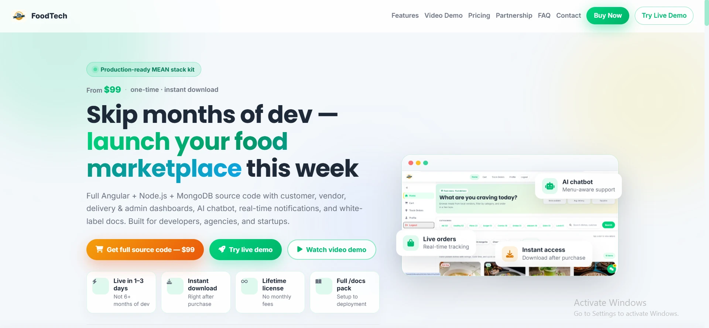
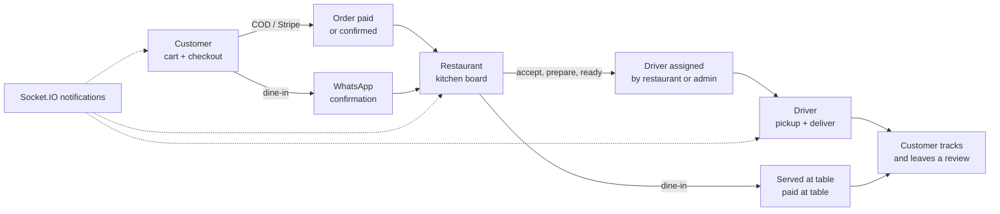
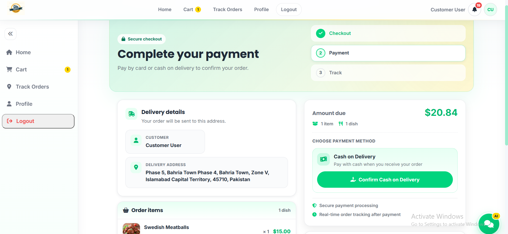
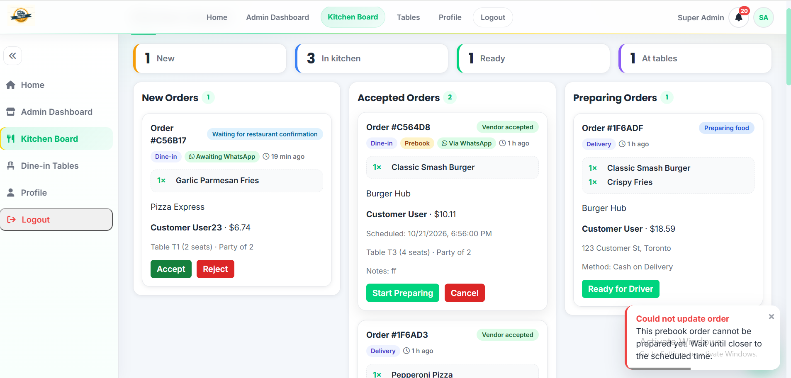
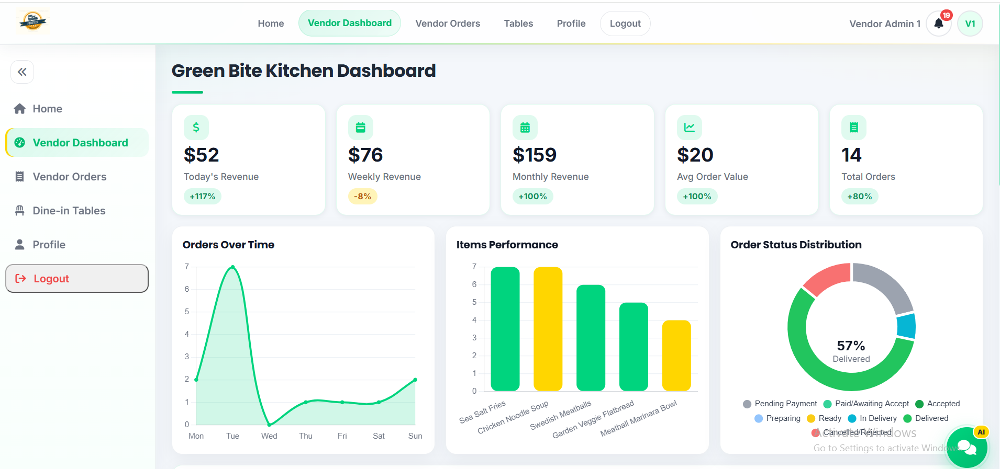
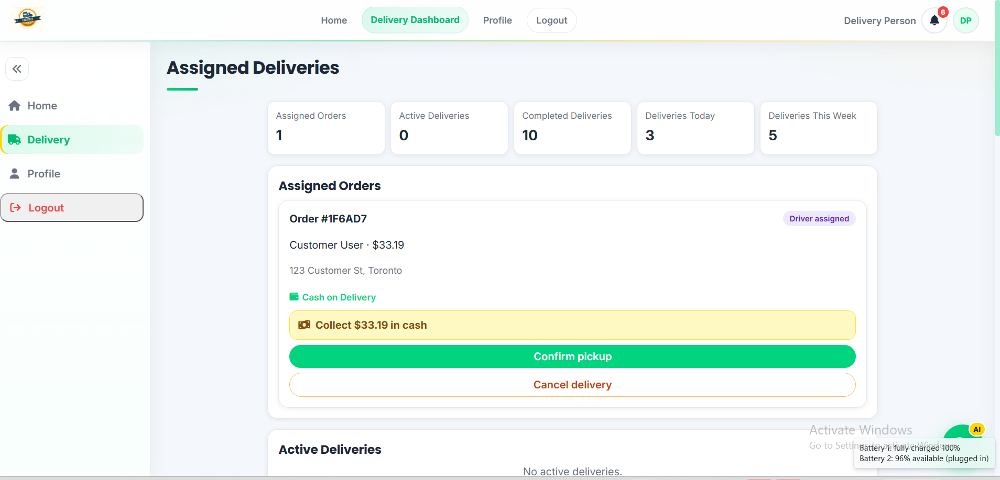
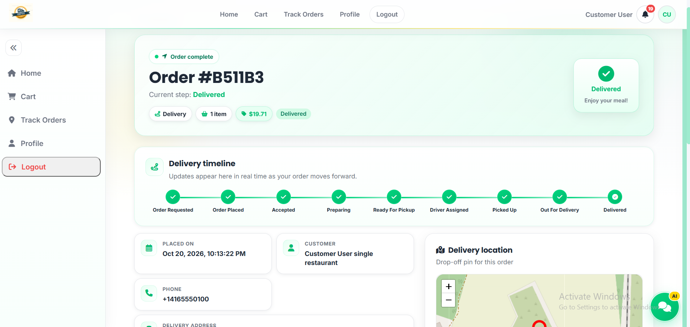
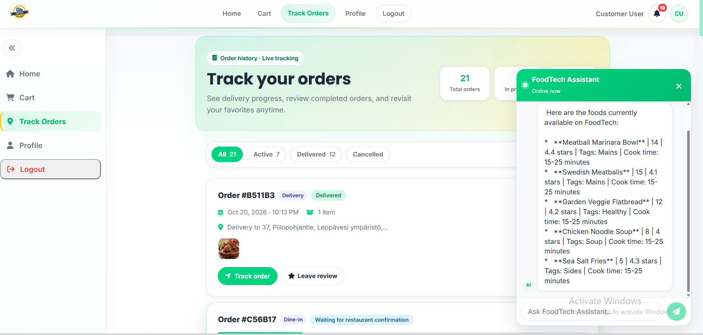
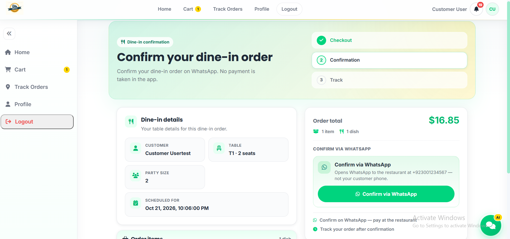
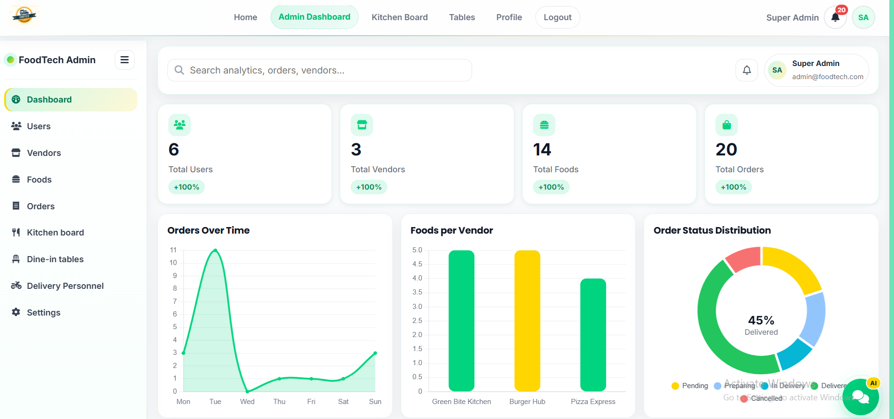

<div align="center">


# FoodTech: Food Ordering Platform and MEAN Starter Kit

### Delivery, dine-in, kitchen board, drivers and an AI menu assistant, ready to run.

[](#tech-stack)
[](#tech-stack)
[](#tech-stack)
[](#tech-stack)
[](#features)
[](#ai-menu-assistant)

**[Live demo](https://foodtech-app-mean-stack.onrender.com/)** ·
**[Video walkthrough](https://www.youtube.com/watch?v=mNUqGhLDCzo)** ·
**[Buy the source code ($50)](https://wanderlust7783.gumroad.com/l/idjucv)** ·
**[Book a restaurant demo](mailto:wandertech58@gmail.com?subject=FoodTech%20for%20my%20restaurant)**



</div>

---

## Contents

- [What FoodTech is](#what-foodtech-is)
- [Two ways to use it](#two-ways-to-use-it)
- [Video walkthrough](#video-walkthrough)
- [The complete workflow](#the-complete-workflow)
  - [1. Customer orders](#1-customer-orders)
  - [2. Restaurant accepts and cooks](#2-restaurant-accepts-and-cooks)
  - [3. Driver delivers](#3-driver-delivers)
  - [4. Customer tracks and reviews](#4-customer-tracks-and-reviews)
  - [5. Dine-in flow](#5-dine-in-flow)
  - [6. Super admin runs the platform](#6-super-admin-runs-the-platform)
- [Order status flows](#order-status-flows)
- [Features](#features)
- [Demo accounts](#demo-accounts)
- [What you get with the source code](#what-you-get-with-the-source-code)
- [Tech stack](#tech-stack)
- [Pricing and licensing](#pricing-and-licensing)
- [Support](#support)

---

## What FoodTech is

FoodTech is a complete food ordering system built on the MEAN stack (MongoDB, Express, Angular 17, Node.js 20) in TypeScript. It covers the whole order, from the customer's cart to the kitchen, the driver and the final review, with a separate dashboard for each person involved:

| Role | Where they work | What they do |
|------|-----------------|--------------|
| **Customer** | `/home`, `/cart`, `/orders`, `/track/:id` | Browse the menu, order for delivery or dine-in, pay, track, review |
| **Restaurant (vendor admin)** | `/vendor/dashboard`, `/vendor/orders`, `/vendor/tables` | Manage the menu and tables, run the kitchen board, assign drivers |
| **Driver** | `/delivery` | Pick up assigned orders, collect cash, mark delivered |
| **Super admin** | `/admin` | Manage every user, restaurant, menu and order across the platform |

One setting (`PLATFORM_MODE`) switches the same codebase between a **single restaurant's own ordering site** and a **multi-vendor marketplace**, without a rebuild.

---

## Two ways to use it

### For developers, agencies and startups: buy the starter kit

Get the full source code and run it yourself. Use it for a client project, an MVP or to learn how a real multi-role app is put together.

- Complete Angular + Node.js + MongoDB source in TypeScript
- All 4 dashboards and every feature in this README
- Demo seed data and a step-by-step setup guide
- One-time payment, instant download, no monthly fees

**[Buy on Gumroad, $50 →](https://wanderlust7783.gumroad.com/l/idjucv)**

### For restaurants and cafés: get it deployed for you

Run your own branded ordering website instead of paying 20–30% commission per order to a marketplace. We set it up for you:

- Your logo, colors and domain
- Menu, tables and staff accounts configured
- Hosting and deployment handled
- Training for your team, plus ongoing support

Runs in `SINGLE_RESTAURANT` mode: customers only see your restaurant, and orders are confirmed on your WhatsApp.

**[Book a free demo →](mailto:wandertech58@gmail.com?subject=FoodTech%20for%20my%20restaurant)** (custom quote based on your setup)

### For IT companies: white-label partnership

Sell FoodTech to your own restaurant clients under your brand. We deploy and support it; you bill your clients. A revenue share model is available.

**[Apply to partner →](mailto:wandertech58@gmail.com?subject=FoodTech%20partnership%20inquiry)**

---

## Video walkthrough

[](https://www.youtube.com/watch?v=mNUqGhLDCzo)

The video walks through every role: ordering, the kitchen board, driver delivery, dine-in with WhatsApp confirmation, and the admin dashboards.

---

## The complete workflow



Every step sends a real-time notification to the people involved (customer, restaurant, driver, admin) over Socket.IO.

### 1. Customer orders

The customer browses the menu, filters by category, adds dishes to the cart and checks out. For delivery they drop a pin on the map; for dine-in they pick a table, party size and time (prebooking is supported).

On the payment page they see only the options that apply:

- **Delivery:** Cash on Delivery, or a card through Stripe (when Stripe keys are set)
- **Dine-in:** confirm on WhatsApp and pay at the restaurant



### 2. Restaurant accepts and cooks

New orders land on the **kitchen board**, grouped as New, Accepted, Preparing and Ready. Staff accept or reject, start preparing, and mark orders ready for the driver. Badges show at a glance whether an order is delivery or dine-in, prebooked, or waiting for WhatsApp confirmation. Prebooked orders can't be prepared too early: they move into preparation automatically based on the restaurant's lead time.



The restaurant dashboard shows today's, weekly and monthly revenue, average order value, orders over time, best-selling items and the order status split.



### 3. Driver delivers

When an order is ready, the restaurant (or super admin) assigns a driver. The driver sees assigned orders with the address, payment method and, for Cash on Delivery, the exact amount to collect. They confirm pickup, go out for delivery and mark it delivered.



### 4. Customer tracks and reviews

Customers follow each order on a live timeline (Order requested → Placed → Accepted → Preparing → Ready → Driver assigned → Picked up → Out for delivery → Delivered) with a drop-off map. After delivery they can rate the order.



The order history page filters active, delivered and cancelled orders. The AI assistant is available on every page and answers from the live menu.



### 5. Dine-in flow

Dine-in customers choose a table and time, then confirm on WhatsApp with one tap. The message goes to the restaurant's own WhatsApp number (a `wa.me` link, so no WhatsApp Business API account is needed). No payment is taken in the app; the customer pays at the table and staff mark the order paid.



Restaurants manage their tables (name, seats, availability) at `/vendor/tables`.

### 6. Super admin runs the platform

The super admin sees totals for users, restaurants, foods and orders, orders over time, foods per restaurant and the platform-wide order status split. From the sidebar they manage users, restaurants, foods, orders, tables and drivers, and can use the kitchen board for any restaurant.



---

## Order status flows

Status changes are enforced on the server by a state machine (`backend/src/constants/order_status.ts` and `services/order-status.service.ts`), so an order can't skip a step or move backwards.

**Delivery**

```
PENDING_PAYMENT → PAYED / WHATSAPP_PENDING → ACCEPTED → PREPARING → READY_FOR_PICKUP
              → ASSIGNED → PICKED_UP → OUT_FOR_DELIVERY → DELIVERED
                      ↘ REJECTED (by the restaurant)     ↘ CANCELED (from ASSIGNED onward)
```

**Dine-in**

```
WHATSAPP_PENDING → ACCEPTED → PREPARING → SERVED → PAID_AT_TABLE → COMPLETED
                         ↘ CANCELED (only before SERVED)
```

`REJECTED`, `CANCELED`, `REFUNDED` and `COMPLETED` are final. Note that `PAYED` also covers Cash on Delivery orders that haven't been paid yet; `paymentStatus` tells you whether money was actually collected.

---

## Features

**Ordering**
- Menu with search, category filters, ratings and food detail pages
- Cart with quantity controls and a mobile cart drawer
- Delivery checkout with a Leaflet map pin, GPS locate and reverse geocoding
- Dine-in with table selection, party size and prebooking
- Order history, live tracking timeline and reviews

**Payments**
- Stripe card payments, verified on the server against the order's stored total
- Stripe webhook (`payment_intent.succeeded`) with signature check
- Cash on Delivery and pay-at-table
- Without Stripe keys, card payment is hidden and only cash is offered

**Restaurant operations**
- Kitchen board: accept, reject, prepare, ready, serve, cancel
- Menu management with image uploads to Cloudinary
- Table management and dine-in availability
- Driver assignment
- Revenue and item performance dashboards

**Platform**
- 4-role access control: JWT auth, route guards, ownership checks on every order
- Single restaurant or multi-vendor with one setting
- Real-time notifications (Socket.IO) with a notification bell for every role
- WhatsApp order confirmation via `wa.me` links (Pakistani `03…` numbers normalized to `92…`)
- Gemini AI menu assistant
- SaaS landing page with pricing, partnership and FAQ sections
- Responsive layout for mobile and desktop

### AI menu assistant

A Google Gemini chatbot answers customer questions using only the live menu from MongoDB (cached for 60 seconds), so it doesn't invent dishes or prices. Try: *"What foods do you have?"*, *"What's the cheapest item?"*, *"How do I place an order?"*

Endpoint: `POST /api/chatbot/send-message`

---

## Demo accounts

The source code ships with a seed script that creates these accounts, so you can try every role right away. All demo passwords are `12345`.

| Email | Role | Try |
|-------|------|-----|
| `customer@foodtech.com` | Customer | `/home`, cart, checkout, `/orders` |
| `vendor@foodtech.com` | Restaurant (Green Bite Kitchen) | `/vendor/dashboard`, `/vendor/orders`, `/vendor/tables` |
| `vendor2@foodtech.com` | Restaurant (Burger Hub) | same as above |
| `vendor3@foodtech.com` | Restaurant (Pizza Express) | same as above |
| `delivery@foodtech.com` | Driver | `/delivery` |
| `super@foodtech.com` | Super admin | `/admin` |

Change or remove these accounts before going live.

---

## What you get with the source code

The source code is sold on [Gumroad](https://wanderlust7783.gumroad.com/l/idjucv) and is not in this repository. The download includes:

| Item | Details |
|------|---------|
| Full source code | Angular 17 frontend and Node.js/Express backend, all in TypeScript |
| All 4 dashboards | Customer, restaurant, driver and super admin |
| Demo seed data | 6 demo accounts, 3 restaurants, menus and sample orders, created with one command |
| Setup guide | Step-by-step install, configuration and deployment (Render or any Node host) |
| Tests | Backend tests with Vitest, frontend tests with Karma/Jasmine |
| Commercial license | One commercial or client project per purchase |

Running it locally takes a MongoDB connection string and two terminals (`npm start` in `backend/` and `frontend/`). Gemini, Cloudinary and Stripe keys are optional; without Stripe, checkout offers cash only.

---

## Tech stack

| Layer | Technology |
|-------|------------|
| Frontend | Angular 17 (NgModules), TypeScript, RxJS, Tailwind CSS, Chart.js (ng2-charts), Leaflet, ngx-toastr, Font Awesome |
| Backend | Node.js 20, Express, TypeScript, Mongoose, Socket.IO, multer |
| Database | MongoDB |
| Payments | Stripe PaymentIntents + webhook, Cash on Delivery, pay at table |
| AI | Google Gemini (`@google/generative-ai`) |
| Media | Cloudinary |
| Auth | JWT (cookie or header), bcrypt, role and ownership guards |
| Tests | Vitest (backend), Karma/Jasmine (frontend) |

---

## Pricing and licensing

| Plan | For | Price |
|------|-----|-------|
| **Source Code** | Developers, freelancers, startups | **$50** one-time on [Gumroad](https://wanderlust7783.gumroad.com/l/idjucv) |
| **Restaurant Launch** | Restaurants and cafés | Custom quote: [book a demo](mailto:wandertech58@gmail.com?subject=FoodTech%20for%20my%20restaurant) |
| **White-label Partner** | IT companies and agencies | Revenue share: [apply](mailto:wandertech58@gmail.com?subject=FoodTech%20partnership%20inquiry) |

Gumroad buyers get a license for one commercial or client project per purchase. Reselling or redistributing the source as a template is not allowed. Full license terms and the setup guide come with the download. Open-source dependencies keep their own licenses.

---

## Support

- Email: [wandertech58@gmail.com](mailto:wandertech58@gmail.com)
- Gumroad: [wanderlust7783.gumroad.com/l/idjucv](https://wanderlust7783.gumroad.com/l/idjucv)
- Video: [YouTube walkthrough](https://www.youtube.com/watch?v=mNUqGhLDCzo)

<div align="center">

**FoodTech**: launch a food ordering platform in days, not months.

If this project helps you, please give it a ⭐

</div>
